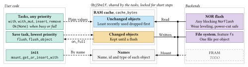

# objshelf

[](https://github.com/MF-Room/objshelf/actions/workflows/ci.yml)
[](LICENSE)

A portable object store that caches plain Rust values on the heap, over pluggable backends from bare-metal to
hosted systems.

Objects have a name and a type. They are read from the storage backend on first use and kept in RAM within a
budget. Changes stay in RAM until you flush them, so the writes to storage only happen when and where you
choose. No function waits: a call that can't be done now returns `Ok(None)`.

<p align="center">
  
</p>

## Usage

```toml
[dependencies]
objshelf = "0.1"
serde = { version = "1", default-features = false, features = ["derive"] }
get-size2 = { version = "0.11", default-features = false, features = ["alloc", "derive"] }
```

You need:

* a heap (`alloc`): a global allocator, for example [`embedded-alloc`](https://crates.io/crates/embedded-alloc);
* [RTIC 2](https://rtic.rs), or any lock that implements its `Mutex` trait (re-exported as `objshelf::Mutex`);
* a backend: NOR flash through any blocking `embedded_storage::nor_flash::NorFlash` driver, or a directory of
  files (feature `fs`).

Any `Serialize + Deserialize + GetSize` type can be stored. `get-size2` measures the RAM an object takes, its
heap included, for the RAM budget. Its derive refers to it by name, so it must be a direct dependency, with the
same version as objshelf's (`0.11`).

The `ObjShelf` is an RTIC `#[shared]` resource. Every function takes it as its first argument, and takes the
lock itself, for short steps only. The [examples](#examples) show a whole app.

## Examples

Both run the same app. It keeps four objects across restarts: a boot count, settings written each time they
change, and samples and a 1 KiB sequencer pattern written with the other changes every 5 rounds. It runs 20
rounds of 250 ms, then prints the objects, `usage`, `wear` and the time each objshelf function took
([Performance](#performance)).

- [`examples/rtic_nor`](examples/rtic_nor): RTIC 2 on the [MSeq board](https://github.com/MF-Room/mseq_pcb), an
  STM32F413 with a W25Q16JV SPI NOR flash, with a small blocking `NorFlash` driver for it. It erases the first
  256 KiB of the flash. With a debug probe: `cd examples/rtic_nor && cargo run --release`.
- [`examples/std_fs.rs`](examples/std_fs.rs): the same app on std, with the file system backend, threads for
  the tasks and a `std::sync::Mutex` for the lock: `cargo run --example std_fs --features fs [dir]`. Run it
  again and the boot count goes up.

## API

In a task, `mem` is `&mut cx.shared.mem`. In `init`, before the memory is shared, it is `&mut mem` on the
owned `ObjShelf`.

| Function | What it does |
|---|---|
| `ObjShelf::mount(config, cache_bytes, on_full)` | Mounts the backend and reads the names of the stored objects, blocking (for `init`). `cache_bytes` is the RAM budget, `on_full` is called when unflushed changes fill it. |
| `ObjShelf::unmount(self)` | Flushes, then unmounts the backend. |
| `list(mem)` | Names of all objects. |
| `get::<T, _>(mem, name)` | Handle to the object `name`, of type `T`. `NotFound` if it doesn't exist. |
| `insert(mem, name, value)` | Adds a new object and returns its handle. `AlreadyExists` if the name is taken, `NameTooLong` over 64 bytes (`MAX_NAME_LEN`). |
| `get_or_insert_with(mem, name, f)` | Handle to the object `name`, inserting `f()` first if it doesn't exist (first boot). |
| `remove(mem, handle)` | Removes the object. |
| `with(mem, &handle, \|v\| ...)` | Runs the closure on the object and returns its result. Reads the object from the backend first if it is not in RAM. |
| `with_mut(mem, &handle, \|v\| ...)` | Same, with mutable access. The change stays in RAM until the next flush. |
| `usage(mem)` | Space of the backend: capacity, used, free, reclaimable by garbage collection, number of objects. |
| `wear(mem)` | Wear of the storage (NOR flash): sectors, erases of the most worn one, all erases added up. `None` for storage that doesn't wear out. |
| `flush(mem)` | Writes the changes to the backend: changed and new objects, each with its name, then the removals. |
| `flush_object(mem, &handle)` | Writes this object if it changed, with its name. The other changes, removals included, stay in RAM. |

`with`, `with_mut`, `insert`, `get_or_insert_with`, `flush` and `flush_object` return `Ok(None)`, having
done nothing, when the call can't be done now. Try again later:

* **Busy:** a flush has the backend, and the call needs it: `with` and `with_mut` on an object not in RAM or
  being written, and the flushes themselves. Only a task that preempts the flush can get it.
* **Full:** unflushed changes fill the RAM budget, for `with_mut` and `insert` (and `get_or_insert_with` when
  it inserts). `on_full` was called to start a flush.

The errors are `NotFound`, `AlreadyExists`, `NameTooLong`, `WrongType` (the handle's type is not the
object's), `TooBig` (the object alone is bigger than the RAM budget) and `Backend`. When an object fails to
write, `flush` still writes the others, and the object stays in RAM for the next flush.

## How it works

* **Writes.** Only `flush`, `flush_object` and `unmount` write to the backend, in the caller's task. Call them
  from a task of the lowest priority, so that every other task keeps running.
* **Locking.** Each function takes the lock for short steps only: never call one inside `lock`. It is held for
  RAM work, the closures (keep them short) and the read of an object not in RAM, not for the writes. Tasks
  that don't share the `ObjShelf` are never blocked by it.
* **RAM budget.** Each object counts its size, its heap and its cache entry. Over budget, the least recently
  used unchanged objects are dropped, and read again when needed. Changed objects stay until a flush.
* **Durability.** A reset loses the changes not flushed. A power cut during a flush leaves each object as it
  was or as written, with its name. Flush objects that must stay consistent with each other together.
* **Names and types.** Each object is stored with its name and a tag of its type, so there is no directory to
  lose. Renaming a type or moving it to another module changes the tag (`WrongType`); changing its fields
  doesn't, and converting stored data after a firmware update is up to the app.

Details: the `ObjShelf` documentation in [`src/api.rs`](src/api.rs).

## Backends

**NOR flash** ([`src/backend/nor`](src/backend/nor/mod.rs)): any blocking `NorFlash` with `READ_SIZE` and
`WRITE_SIZE` of 1 and an `ERASE_SIZE` that is a multiple of 256 (SPI NOR, internal MCU flash, a RAM simulation
for tests), on a region of 3 sectors to 16 MiB.

* Objects are split in 256-byte pages. A new version counts once all its pages read back right and its commit
  byte is programmed, so a power cut leaves the old value or the new one, even with weak bits.
* A page that reads back wrong is written again elsewhere (`VerifyFailed` after 3 tries). Bit rot is detected
  by CRC (`Corrupt`), not corrected.
* Garbage collection relocates the live pages of the sector with the most garbage, keeping two sectors free
  for it. New pages go to the least worn free sector, and data that never changes is moved now and then
  (static wear leveling).

**File system** ([`src/backend/fs`](src/backend/fs/mod.rs), feature `fs`): one file per object in a directory,
on Linux and other Unix systems.

```rust
use objshelf::backend::fs::{FsBackend, FsConfig};

let config = FsConfig { dir: "/var/lib/app/objects".into(), capacity: 64 << 20, direct_io: true };
let mut mem = ObjShelf::<FsBackend>::mount(config, 1 << 20, || {})?;
```

* On Linux, files are read and written with `O_DIRECT`, past the page cache, which would hold a second copy.
* A write goes to a temporary file, synced and renamed over the object's file, then the directory is synced:
  after a crash, each object holds its old or its new value.
* `capacity` is a quota on the files. A lock file makes a second mount of the directory fail with `Locked`.

**FRAM**: TODO.

The module documentation of each backend gives its requirements, guarantees, and time and space complexity
(`cargo doc --features fs --document-private-items`).

## Lifetime

A NOR sector endures a limited number of erases (100 000 for the W25Q16JV), and wear leveling spreads them
over all the sectors, so:

```text
lifetime ≈ sectors × endurance × pages written per erase / pages written per day
```

A fuller flash leaves less garbage in each sector, so garbage collection moves more live pages for each
erase. Measured with 4 KiB sectors and one-page objects updated at random
(`cargo test --release -- --ignored --nocapture pages_per_erase`):

| Flash full | Pages per erase | 1 page/s, whole W25Q16JV | 1 page/min, whole W25Q16JV |
|---|---|---|---|
| 25% or less | 15.0 | 24 years | 1 400 years |
| 50% | 12.5 | 20 years | 1 200 years |
| 75% | 7.5 | 12 years | 730 years |
| 90% | 3.7 | 6 years | 360 years |

At runtime, `wear(mem)` gives the erases so far, kept across reboots: read `total_erases` twice, some time
apart, for the erase rate, then `remaining_erases(endurance)` / rate is the time left.

## Performance

The time each function took in the [examples](#examples), lock included, in a run that found the objects of
the previous one. Both are release builds.

| Function | Calls | MSeq board, mean | longest | PC, mean | longest |
|---|--:|--:|--:|--:|--:|
| `mount` | 1 | 234.7 ms | 234.7 ms | 675.4 µs | 675.4 µs |
| `list` | 2 | 16.3 µs | 16.3 µs | 2.7 µs | 3.5 µs |
| `get_or_insert_with` | 4 | 3.2 µs | 4.6 µs | 726 ns | 936 ns |
| `with` | 6 | 423.5 µs | 1.8 ms | 58.7 µs | 128.5 µs |
| `with_mut` | 61 | 13.6 µs | 307.0 µs | 2.8 µs | 102.7 µs |
| `flush_object` | 21 | 2.6 ms | 36.7 ms | 16.8 ms | 17.7 ms |
| `flush` | 5 | 19.8 ms | 41.7 ms | 15.5 ms | 19.6 ms |
| `usage` | 1 | 400 ns | 400 ns | 190 ns | 190 ns |
| `wear` | 1 | 460 ns | 460 ns | 147 ns | 147 ns |
| `unmount` | 1 | | | 18.8 µs | 18.8 µs |

* **MSeq board** ([mseq_pcb](https://github.com/MF-Room/mseq_pcb)): STM32F413 at 100 MHz, W25Q16JV on SPI at
  25 MHz, NOR region of 256 KiB (64 sectors), RAM budget of 16 KiB, `opt-level = "s"` with LTO, timed with the
  cycle counter. Mount reads every page of the region's formatted sectors, about 0.23 ms a page with the
  example's driver. The longest flushes include a sector erase by garbage collection (about 40 ms).
* **PC**: Intel NUC10i7FNK (Core i7-10710U, 16 GB), Samsung 980 PRO NVMe SSD, ext4 with `O_DIRECT`, NixOS
  26.05, Linux 6.18, Rust 1.100. A write of an object takes about 15 ms, nearly all of it waiting for the SSD:
  the `O_DIRECT` write and the syncs of the file and of the directory.

`with` and `with_mut` are longest when they read an object that is not in RAM.

## License

Copyright © 2026 MF Room.

Licensed under the GNU Lesser General Public License, version 2.1 only (SPDX-License-Identifier:
`LGPL-2.1-only`). See [LICENSE](LICENSE) for the full text.
